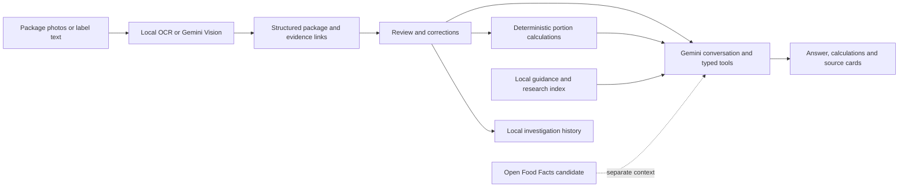

# NutriScan

> **An India-first food-package intelligence workspace for reading labels, checking portions and exploring evidence.**

NutriScan brings package photographs, structured label readings, user corrections, deterministic nutrition calculations and a Gemini-assisted conversation into one local-first application. It is a seventh-semester Computer Science and Engineering project at KIIT Deemed to be University.

[](https://nextjs.org/) [](https://react.dev/) [](https://www.typescriptlang.org/) [](https://ai.google.dev/)

## Why NutriScan

A package can present its ingredients, nutrition table, serving size and claims on different sides. A number is useful only when its nutrient, unit, qualifier and serving basis remain attached to it. NutriScan combines image reading with a structured evidence record so users can inspect what was read, correct it, calculate a portion and ask follow-up questions without losing the original context.

## What you can do

- **Read a package:** add multiple photos, paste label text, or use local Tesseract or PaddleOCR alongside configured Gemini Vision reconstruction.
- **Review the reading:** inspect nutrition rows, ingredients, additives, claims and their linked observations or source photos. Correct uncertain values without erasing the original reading.
- **Explore a portion:** calculate compatible nutrient quantities for grams, millilitres, servings, pieces or packages when the necessary conversion is known.
- **Ask follow-up questions:** use a configured Gemini model with the saved package state, calculator tools and applicable source evidence. The model selector and analysis method remain separate controls.
- **Inspect evidence:** expand source cards, calculations and tool activity. Open Food Facts records are community-supplied comparison candidates, separate from photographed label readings.
- **Return to an investigation:** conversations and corrections are saved in the browser, with individual deletion and a confirmed clear-history action. Original photos and profile fields are not saved in scan history.

## How it works



The browser manages the investigation and local history. The local Next.js server validates requests, handles configured Gemini access and runs the research and calculation tools. Package observations, community records and scientific sources have different provenance; an external catalog match does not replace a photographed reading.

Gemini can use the saved reconstruction rather than resending photographs for ordinary follow-ups. Ingredient and guidance retrieval can supply relevant source-linked context, but source availability and a citation do not guarantee that a generated claim is correct or applicable.

## Privacy and model access

- Photos and optional profile details stay in the browser until a disclosed remote action is chosen. Initial Gemini reconstruction can send the selected photos or label text; optional profile sharing requires separate consent.
- After reconstruction, a usable product barcode or interpreted identity can be sent to Open Food Facts for a community-record lookup. The lookup does not intentionally send the profile or photographs.
- The example configuration keeps Gemini disabled. Keys are server-side; do not commit `.env.local` or place credentials in browser-visible variables.
- Optional paid access and fallback require explicit server configuration and spending limits. The selected model, account entitlements and provider availability determine which calls can run and whether charges apply.
- Local history is specific to the browser profile and may contain sensitive questions. The application does not claim encrypted history or cloud synchronization.

## Run locally

Requirements: Node.js 22.13 or newer and npm. The development server binds to loopback at port 3400.

```bash
git clone https://github.com/Suvichan2005/NutriScan.git
cd NutriScan
npm ci
npm run dev
```

Open [http://127.0.0.1:3400](http://127.0.0.1:3400). Local label reading can be used without enabling Gemini. For optional Gemini access, copy `.env.example` to `.env.local` **only if you do not already have a configuration**, then supply your own server-side credentials and settings. `.env.example` documents the free and paid controls; do not commit private keys.

`npm ci` prepares the locally served English Tesseract assets. Optional PaddleOCR and semantic-search assets have their own availability and setup requirements; normal startup does not require downloading an entire research corpus.

## Verification

```bash
npm run typecheck
npm test
npm run build
npm start
```

Stop the development server before running `npm start`, since both use port 3400. Browser acceptance, provider-backed checks and experiments should be described with their actual inputs and configurations; passing software tests does not establish label-reading or medical accuracy. Historical evaluation and acceptance notes are under [`docs/`](docs/).

## Repository map

```text
src/components/          Scanner, package inspector, chat and evidence UI
src/lib/                 Shared contracts, calculations, corrections and storage
src/lib/server/          Gemini orchestration, retrieval and API support
src/modules/ocr/         OCR implementations and evaluation contracts
src/modules/inference/   Inference validation and evidence handling
src/modules/knowledge/   Ingredient and source knowledge
src/app/api/             Local application API routes
data/                    Tracked indexes and evaluation definitions
docs/                    Design, evaluation and operational documentation
```

## Scope and limitations

NutriScan is a local-first project prototype, not an authenticated public hosting service or a medical device. OCR and model interpretations can be wrong; missing values are not zero. Ingredient presence alone does not establish a dose, health effect or personal safety. Community records may refer to a different package or be incomplete, and local guidance may not cover every question. Check the package and original sources when a decision depends on them.

## Project team

Suvansh Agarwal · Subham Kumar Dash · Yug Agarwal · Yashovardhan Singh

School of Computer Engineering, KIIT Deemed to be University. Guide: Prof. Prasenjit Maiti.
