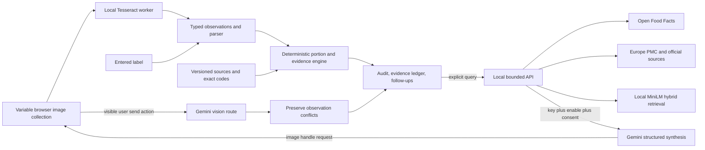

# Architecture

See [architecture decisions](ARCHITECTURE_DECISIONS.md) for tradeoffs and boundaries.

`src/lib/contracts.ts` is the single shared schema source. The contributor-owned technical boundaries now live in `src/modules/ocr/`, `src/modules/knowledge/`, and `src/modules/inference/`, each with a narrow public entry point. `src/lib/` retains owner-controlled compatibility facades and integration: browser history/profile storage and barcode composition stay in `browser.ts`; the application injects the Knowledge additive resolver into OCR; local Node embedding retrieval is exposed through the Knowledge `server.ts` entry; and Gemini SDK calls, consent, image inspection, external HTTP policy, routes, session state and UI stay application-owned. The modules do not import each other's internals. `profileSchema` contains only optional, separately declared context and starts empty. Existing tests exercise these boundaries in the repository; the modules are not separately published packages.
