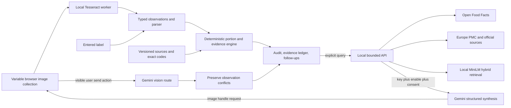

# Architecture

See [architecture decisions](ARCHITECTURE_DECISIONS.md) for tradeoffs and boundaries.

`src/lib/contracts.ts` is the shared schema. `parser.ts`, `engine.ts`, `knowledge.ts` and `reconcile.ts` are independent pure modules. `profileSchema` contains only optional, separately declared context and starts empty. `browser.ts` owns image attachments/OCR/IndexedDB. `semantic.ts` owns local Node inference and index validation. `server/` isolates external HTTP and provider calls. `app/api/` validates public entry points. The current UI remains in a single component with separate styling; future work can split panels without changing evidence contracts.
