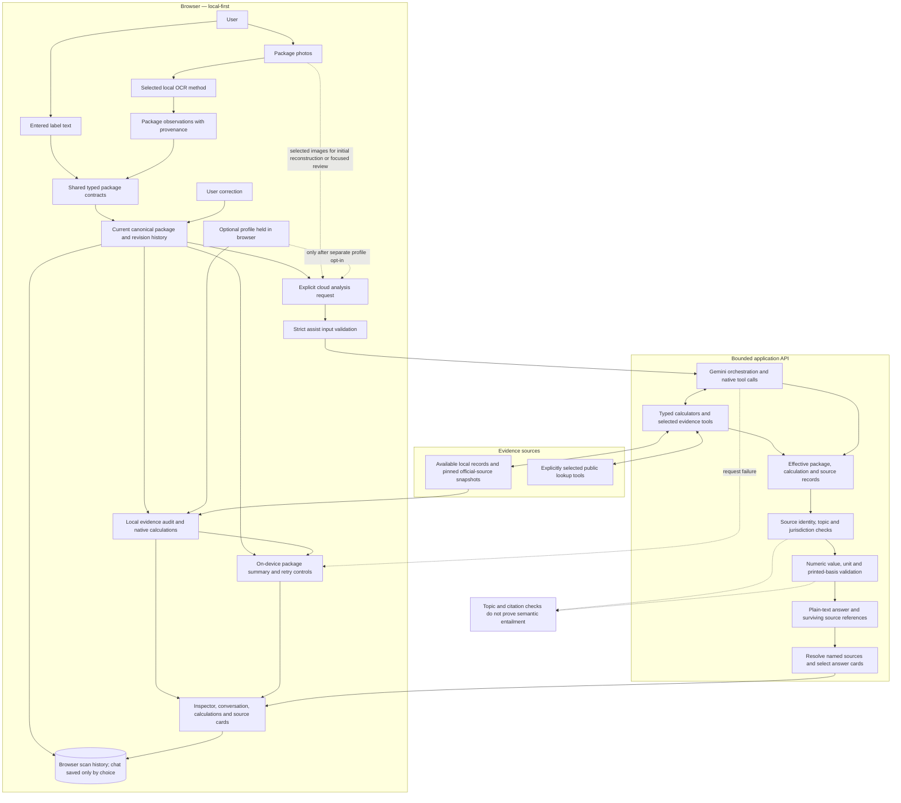

# NutriScan system flow

See [architecture decisions](ARCHITECTURE_DECISIONS.md) for design tradeoffs and boundaries. This view follows the current implementation from browser capture to saved, inspectable answers; it does not imply that model interpretations or OCR observations are verified facts.

## Privacy and evidence boundaries

- Photos, profile fields, OCR processing and package corrections stay in the browser unless the user chooses a disclosed cloud action. The initial reconstruction and a focused image review can send selected, locally resized photos; normal follow-up questions use the saved package reconstruction and linked OCR evidence without replaying photos. Profile sharing requires a separate opt-in.
- Public lookup tools receive bounded terms from the current question or package text, not photos or separately stored profile fields. A question can still contain personal details, so the UI warns users not to place health information in a public search. Returned records remain candidates and do not replace photographed package facts.
- OCR and model reconstruction produce observations or provisional readings. Corrections create current package state while retaining superseded observations and provenance. Missing nutrient values remain unknown, not zero.
- The production answer route is plain text. It checks source references for availability, topic and jurisdiction and validates numeric values/bases against package evidence and typed calculations. Source cards come from references in surviving prose. Non-numeric scientific claims are not deterministically checked for semantic support; a relevant citation alone does not establish entailment.
- If cloud analysis fails, the browser can present a local package summary. Switching back to Gemini sends nothing; retry is a separate user action and replaces the existing turn.

## Implementation and acceptance trace

| Product path | Implementation | Acceptance evidence | What the evidence establishes |
| --- | --- | --- | --- |
| Local photo reading, correction and portion arithmetic | [`nutriscan.tsx`](../src/components/nutriscan.tsx), [`ocr/browser.ts`](../src/modules/ocr/browser.ts), [`correction.ts`](../src/lib/correction.ts), [`engine.ts`](../src/lib/engine.ts) | [`label-correction-browser.json`](evidence/label-correction-browser.json) | Genuine-photo UI correction, linked original readings, and calculation/save behavior at mobile and desktop. It is not an OCR accuracy estimate. |
| Local answer breadth, source cards and natural follow-up | [`followup-evidence.ts`](../src/lib/followup-evidence.ts), [`answer-evidence.ts`](../src/lib/answer-evidence.ts), [`gemini-tools.ts`](../src/lib/server/gemini-tools.ts) | [`m2-local-thread-browser-20261027.json`](evidence/m2-local-thread-browser-20261027.json), [`local-evidence-browser.json`](evidence/local-evidence-browser.json) | Provider-free local answers and source presentation across documented scenarios. It does not establish live Gemini tool selection or scientific entailment. |
| Production answer validation and source selection | [`gemini.ts`](../src/lib/server/gemini.ts), [`answer-evidence.ts`](../src/lib/answer-evidence.ts), [`inference/core.ts`](../src/modules/inference/core.ts) | [production answer evidence flow](diagrams/production-answer-evidence-flow.md) | Code-path behavior for source scope, numeric validation and source-card selection. Non-numeric semantic support remains open. |
| Failed-request recovery and saved scan continuity | [`nutriscan.tsx`](../src/components/nutriscan.tsx), [`browser.ts`](../src/lib/browser.ts) | [`m6-retry-recovery-20261027.json`](evidence/m6-retry-recovery-20261027.json) | Mobile/desktop client recovery with intercepted failure/success responses. It is not live provider acceptance. |

These receipts support engineering traceability only. They do not replace Subham's independent evaluation, human-reviewed final package references, or the unavailable private KIIT report/template.

[`contracts.ts`](../src/lib/contracts.ts) is the shared contract source. `src/modules/ocr/`, `src/modules/knowledge/`, and `src/modules/inference/` expose narrow module boundaries; `src/lib/` contains application-owned integration, compatibility facades and browser storage. The application owns consent, API orchestration, provider calls, session state and React rendering.
