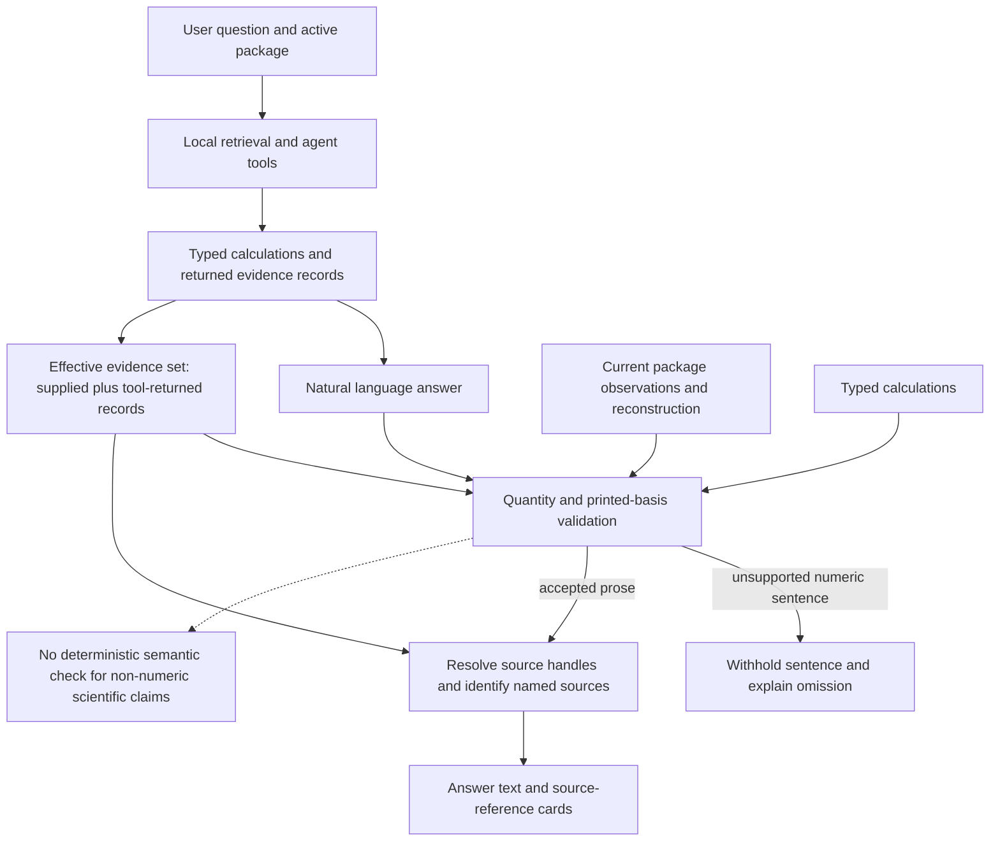

# Production answer evidence flow

This diagram follows the natural conversational follow-up path in `src/lib/server/gemini.ts`. It distinguishes evidence availability and citation display from semantic proof of a scientific assertion.

## What the implementation establishes

- The conversation route merges records supplied with the request and records returned by tools into the effective evidence set, then passes that set to `validateNaturalAnswerText`.
- The natural answer validator verifies numeric values and printed bases against current package evidence, eligible source text and typed calculations. It withholds unsupported numeric sentences while preserving independently supported prose.
- Native source handles resolve only against the effective evidence set. Consumer source cards are selected from source identities named in the accepted prose; unused retrieval candidates do not automatically become citations.
- These checks establish data flow, numeric support and traceable reference presentation. They do not show that a source semantically entails every qualitative scientific statement in the natural answer.

## Acceptance gap and evidence boundary

The production natural-answer path has no deterministic semantic entailment check for non-numeric scientific assertions. Prompt instructions, retrieved source availability and a citation card cannot by themselves prove that a medical or nutrition statement is supported. Treat unsupported non-numeric claim rejection as an open M2 engineering/acceptance gap; resolve it through a bounded, evidence-linked design and distinct scenario acceptance before claiming closure.

This is a code-path audit, not a fresh provider response or scientific evaluation. It uses implementation evidence in `src/lib/server/gemini.ts` and `src/modules/inference/core.ts`; it does not replace Subham's independent evaluation or the missing private KIIT report/template.
