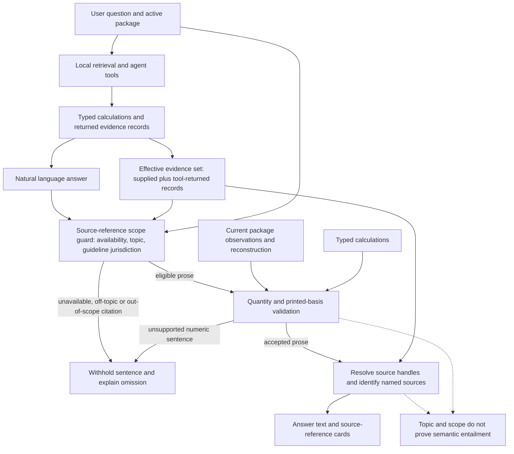

# Production answer evidence flow

This diagram follows the natural conversational follow-up path in `src/lib/server/gemini.ts`. It distinguishes evidence availability and citation display from semantic proof of a scientific assertion.

## What the implementation establishes

- The conversation route merges records supplied with the request and records returned by tools into the effective evidence set. Before numeric validation, a sentence with an explicit source handle, URL, title or uniquely identifiable publisher is retained only if its source is in this set, topically relevant to the question and in jurisdictional scope when it is a guideline. A user asking to inspect a supplied reference can inspect it directly.
- The natural answer validator verifies numeric values and printed bases against current package evidence, eligible source text and typed calculations. It withholds unsupported numeric sentences while preserving independently supported prose.
- Consumer source cards are selected from source identities named in the surviving prose; unused or scope-filtered retrieval candidates do not automatically become citations, though they remain available in the inspector.
- These checks establish data flow, numeric support, traceable references and topical/jurisdiction scope. They do not show that a source semantically entails every qualitative scientific statement in the natural answer. Unreferenced assertions and incorrect claims linked to a merely topical source are still not deterministically rejected.

## Acceptance gap and evidence boundary

The production natural-answer path has no deterministic semantic entailment check for non-numeric scientific assertions. Prompt instructions, retrieved source availability and a citation card cannot by themselves prove that a medical or nutrition statement is supported. Treat unsupported non-numeric claim rejection as an open M2 engineering/acceptance gap; resolve it through a bounded, evidence-linked design and distinct scenario acceptance before claiming closure.

This is a code-path audit, not a fresh provider response or scientific evaluation. It uses implementation evidence in `src/lib/server/gemini.ts` and `src/modules/inference/core.ts`; it does not replace Subham's independent evaluation or the missing private KIIT report/template.
