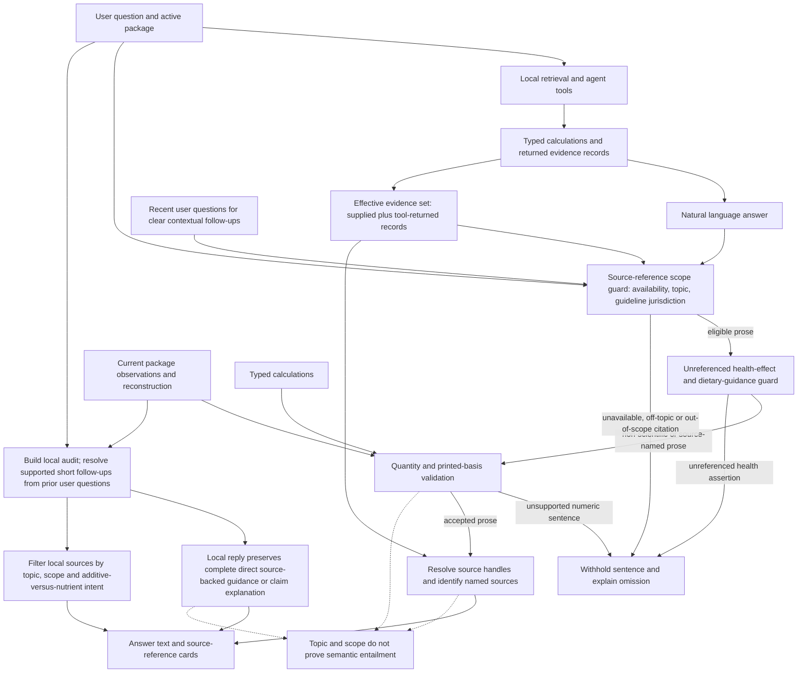

# Production answer evidence flow

This diagram follows the natural conversational follow-up path in `src/lib/server/gemini.ts`. It distinguishes evidence availability and citation display from semantic proof of a scientific assertion.

## What the implementation establishes

- The conversation route merges records supplied with the request and records returned by tools into the effective evidence set. Before numeric validation, a sentence with an explicit source handle, URL, title or uniquely identifiable publisher is retained only if its source is in this set, topically relevant to the question and in jurisdictional scope when it is a guideline. Clear contextual follow-ups can also use bounded prior user questions for topic continuity; prior assistant text is not evidence, and standalone new topics do not inherit history. A user asking to inspect a supplied reference can inspect it directly.
- The natural answer validator verifies numeric values and printed bases against current package evidence, eligible source text and typed calculations. It withholds unsupported numeric sentences while preserving independently supported prose.
- Consumer source cards are selected from source identities named in the surviving prose; unused or scope-filtered retrieval candidates do not automatically become citations, though they remain available in the inspector.
- These checks establish data flow, numeric support, traceable references and topical/jurisdiction scope. They do not show that a source semantically entails every qualitative scientific statement in the natural answer. The conservative pattern guard catches obvious unreferenced health effects, safety claims and dietary advice; other unreferenced scientific statements and incorrect claims linked to merely topical sources can still pass.

## Local deterministic thread path

The UI derives its local audit from the active package. A bounded prior user question may resolve a clearly contextual follow-up, but assistant prose is not carried as evidence. Direct source-backed guidance and claim criteria keep their useful explanation and qualifications; comparisons stay concise. Topic/scope-filtered source identities determine which local evidence cards appear. An additive identity alone cannot establish that a nutrient is present or quantify it.

The production natural-answer path also withholds obvious unreferenced health-effect, safety and dietary-guidance sentences while retaining independently supported package prose and explicit limitations. A cited source still passes based on identity, topic and scope; the route does not deterministically test semantic entailment. The structured claim-span validator exists separately and is not yet wired into this natural-answer flow.

## Acceptance gap and evidence boundary

The production natural-answer path has no deterministic semantic entailment check for non-numeric scientific assertions. Prompt instructions, retrieved source availability and a citation card cannot by themselves prove that a medical or nutrition statement is supported. Treat unsupported non-numeric claim rejection as an open M2 engineering/acceptance gap; resolve it through a bounded, evidence-linked design and distinct scenario acceptance before claiming closure.

This is a code-path audit, not a fresh provider response or scientific evaluation. It uses implementation evidence in `src/lib/server/gemini.ts` and `src/modules/inference/core.ts`; it does not replace Subham's independent evaluation or the missing private KIIT report/template.
